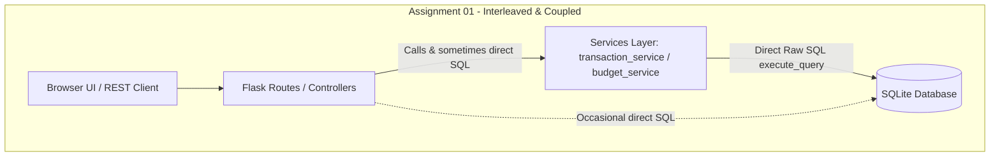
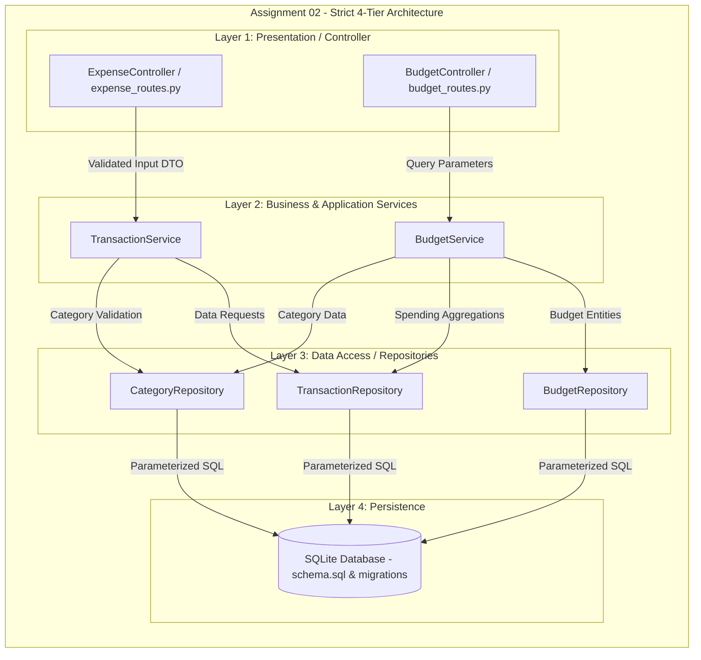

# Part B — Refactoring Report: Layered Architecture

| Item | Details |
| :--- | :--- |
| **System** | ExpenseMate — Personal Expense Manager |
| **Architectural Target** | Strict 4-Tier Layered Architecture: `Controller → Services → Repository → Database` |
| **Refactored Features** | Feature 1: "Add Expense" & Feature 2: "Monthly Budget Summary" |
| **Dependency Rule** | Downward dependency flow only; no skip-level calls or upward dependencies |

---

## 1. Before vs. After Architecture

### Before Architecture (Assignment 01 Baseline)
In Assignment 01, ExpenseMate used a hybrid pattern where controllers (route handlers) and services directly executed raw SQL statements via SQLite `execute_query`. Business rules, calculations, and database mutations were interleaved inside single procedural functions.



### After Architecture (Assignment 02 Required Layered Architecture)
The system is refactored into four distinct, loosely-coupled layers where each layer has a strictly defined responsibility and zero direct SQL is allowed outside repositories.



---

## 2. Refactored Features Detailed Trace

### Feature 1: "Add Expense"
* **Controller Layer** (`routes/expense_routes.py`):
  - Validates authentication session (`@login_required`).
  - Extracts and sanitizes request JSON payload (`category_id`, `amount`, `transaction_date`, `payment_method`, `notes`).
  - Invokes `TransactionService.add_transaction(...)`.
  - Translates domain outcomes into HTTP responses (`201 Created` with JSON or `400 Bad Request` with descriptive error).
* **Service Layer** (`services/transaction_service.py`):
  - Enforces domain validation: positive amount, valid date format, supported transaction type.
  - Verifies category existence and type compatibility (`expense` vs `income`) via `CategoryRepository.get_by_id()`.
  - Coordinates creation by invoking `TransactionRepository.create(...)`.
  - Returns the newly created transaction domain object.
* **Repository Layer** (`repositories/transaction_repository.py`):
  - Executes parameterized `INSERT INTO transactions (...) VALUES (?, ?, ...)` ensuring SQL injection safety.
  - Commits database transaction and returns inserted primary key.
* **Database Layer**:
  - Persists record into `transactions` table in `expensemate.db`.

### Feature 2: "Monthly Budget Summary"
* **Controller Layer** (`routes/budget_routes.py`):
  - Receives HTTP `GET /api/budgets?month=...&year=...`.
  - Parses query parameters with sensible fallbacks (current month/year).
  - Calls `BudgetService.get_monthly_budget_summary(user_id, month, year)`.
  - Returns structured JSON response for frontend progress bars and alert cards.
* **Service Layer** (`services/budget_service.py`):
  - Fetches overall budget allocation from `BudgetRepository.get_overall_budget()`.
  - Fetches monthly total spent from `TransactionRepository.get_monthly_spending()`.
  - Fetches individual category budgets via `BudgetRepository.get_category_budgets()`.
  - Iterates categories, fetching respective spent sums from `TransactionRepository.get_category_monthly_spending()`.
  - Computes business domain logic:
    - $\text{Remaining} = \text{Budget} - \text{Spent}$
    - $\text{Percentage} = (\text{Spent} / \text{Budget}) \times 100$
    - Status evaluation: `'Normal'` ($< 80\%$), `'Warning'` ($80\% - 99\%$), `'Exceeded'` ($\ge 100\%$).
* **Repository Layer** (`repositories/budget_repository.py` & `transaction_repository.py`):
  - Purely executes data retrieval queries without performing status checks or budget health evaluation.
* **Database Layer**:
  - Stores persistent state across `budgets`, `categories`, and `transactions`.

---

## 3. Code-Quality Improvements Identified

| # | Code-Quality Indicator | Before Refactoring | After Refactoring |
| :- | :--- | :--- | :--- |
| **1** | **Separation of Concerns (SoC)** | Routes and services executed raw SQL queries directly using SQLite cursor calls. | Complete decoupling: Controllers handle HTTP, Services govern business rules, Repositories handle data access. Zero SQL in controllers/services. |
| **2** | **Testability & Mockability** | Testing service calculations required active database connections with predefined database seeds. | Services accept repository dependencies via constructor injection (`__init__(self, repo=None)`), allowing full unit testing with mock repositories. |
| **3** | **Single Responsibility Principle (SRP)** | Single functions (e.g., `set_budget` or `get_budgets`) handled SQL parsing, query execution, data conversion, and percentage math. | Repositories only fetch data; Services only compute rules and coordinate; Controllers only handle HTTP translation. |

---

## 4. Verification Evidence
A dedicated repository test suite was implemented in [`tests/test_repositories.py`](file:///C:/Users/Admin/.gemini/antigravity/scratch/expensemate/tests/test_repositories.py):
* `test_category_repository`: Verifies category retrieval by ID, name, and type.
* `test_transaction_repository_crud_and_spending`: Verifies transaction creation with payment methods, monthly spending sums, pagination, and deletion.
* `test_budget_repository_crud`: Verifies overall and category budget upserts and retrievals.

### Test Execution Result:
```text
tests\test_repositories.py ...                                           [100%]
============================== 3 passed in 2.99s ==============================
```
Full suite regression: **16 passed out of 16 tests** (10 baseline tests + 3 migration tests + 3 repository tests).
